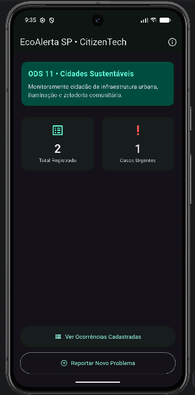
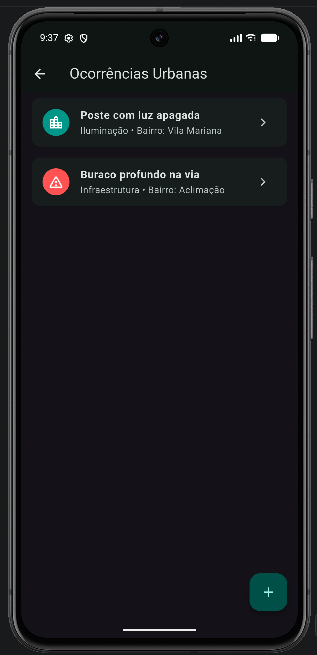
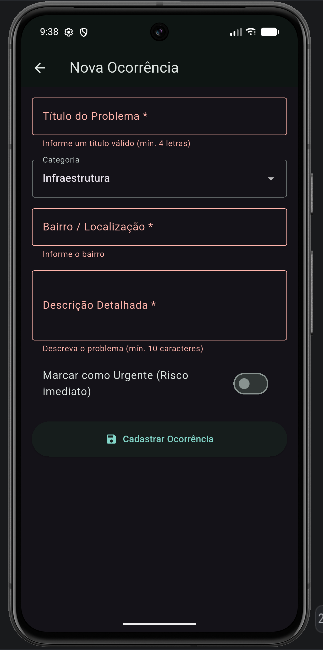
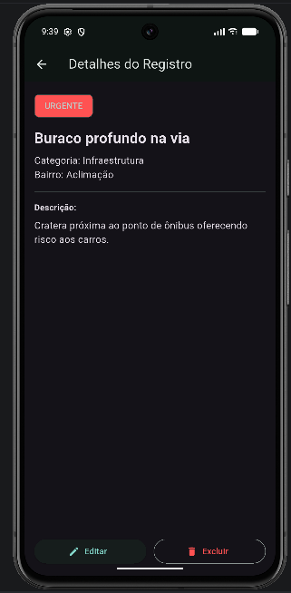
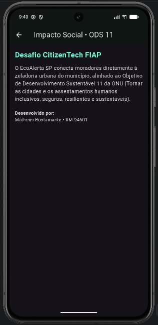

# EcoAlerta SP • CitizenTech (ODS 11)

MVP Mobile desenvolvido em Flutter para a Avaliação Específica (DP 2026.2) da disciplina **Desenvolvimento Cross-Platform com Flutter** — 3º Ano de Sistemas de Informação (FIAP).

## 1. Identificação
* **Projeto:** EcoAlerta SP — Zeladoria Urbana Colaborativa
* **Integrante:** Matheus Bustamante — **RM 94601**

## 2. Sobre o Projeto (CitizenTech & ODS)
* **Problema Real:** Buracos nas vias públicas, postes com iluminação apagada, descarte irregular de lixo e problemas de mobilidade urbana nos bairros de São Paulo frequentemente demoram a ser mapeados e priorizados.
* **Público-Alvo:** Cidadãos moradores dos bairros e agentes públicos de zeladoria municipal.
* **Conexão com os ODS da ONU:** Alinhado diretamente ao **ODS 11 (Cidades e Comunidades Sustentáveis)**, promovendo a participação cidadã ativa para tornar os bairros mais seguros, inclusivos e resilientes.
* **Funcionalidades do MVP:** Dashboard inicial com indicadores dinâmicos (total de ocorrências e casos urgentes), listagem reativa de ocorrências, cadastro e edição com validação de formulário, visualização detalhada e exclusão com confirmação.

## 3. Arquitetura e Persistência Local (SQLite)
O projeto segue arquitetura desacoplada em camadas (`models`, `database`, `providers`, `widgets`, `screens`) com gerenciamento de estado reativo via **Provider (`ChangeNotifier`)** e execução **Zero-Config** utilizando **SQLite (`sqflite`)**.

Na primeira execução (`onCreate`), o banco local `ecoalerta.db` cria automaticamente a tabela `ocorrencias` e insere uma carga inicial de registros (*seed*):

| Coluna | Tipo SQLite | Descrição |
| :--- | :--- | :--- |
| `id` | `INTEGER PRIMARY KEY AUTOINCREMENT` | Identificador único da ocorrência |
| `titulo` | `TEXT NOT NULL` | Título resumido do problema urbano |
| `categoria` | `TEXT NOT NULL` | Categoria (Infraestrutura, Iluminação, Limpeza Urbana, Mobilidade) |
| `bairro` | `TEXT NOT NULL` | Bairro ou localização do registro |
| `descricao` | `TEXT NOT NULL` | Detalhamento completo da ocorrência |
| `urgente` | `INTEGER NOT NULL` | Indicador de urgência (`1` = Urgente, `0` = Normal) |

## 4. Galeria de Telas (Screenshots)
| Home (Dashboard) | Listagem Dinâmica | Formulário com Validação | Detalhes do Registro | Sobre / ODS 11 |
| :---: | :---: | :---: | :---: | :---: |
|  |  |  |  |  |

## 5. Instruções de Execução
1. Clonar o repositório:
   ```bash
   git clone [https://github.com/Matbusta20/dp_flutter_rm94601_ecoalerta.git](https://github.com/Matbusta20/dp_flutter_rm94601_ecoalerta.git)
   cd dp_flutter_rm94601_ecoalerta